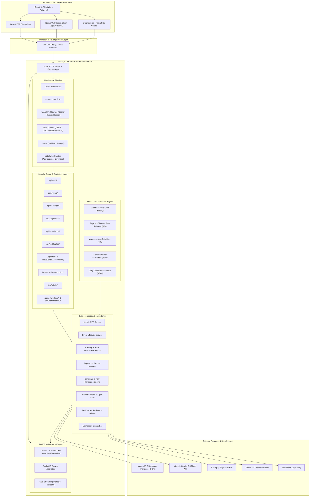

# CollegeEvents — Target Express & Node.js Architecture Specification

> **Target Platform:** Node.js 20+ LTS (ES Modules)  
> **Framework:** Express.js 4.19+ (or 5.0)  
> **Database:** MongoDB 7 via Mongoose 8.x  
> **Real-Time Layer:** Dual-Stack Real-Time Engine (Native STOMP-over-WebSocket for React zero-change compatibility + Socket.IO) + SSE  
> **AI Provider:** Google Gemini API via official `@google/genai` Node.js SDK  
> **Payment Gateway:** Razorpay Node.js SDK (`razorpay`)  
> **Document Processing:** `pdf-lib` / `pdfkit` (Certificate stamping) & `qrcode` (ZXing replacement)

---

## 1. System Architecture Overview & Dependency Diagram



---

## 2. Directory & Modular File Structure

```
backend-node/
├── .env.example                     # Environment template (no secrets)
├── package.json                     # "type": "module", dependencies
├── server.js                        # App bootstrap, HTTP + WebSocket server setup
├── src/
│   ├── config/                      # Environment and SDK configurations
│   │   ├── env.js                   # Typed dotenv loader with Joi validation
│   │   ├── database.js              # Mongoose connection & pool settings
│   │   ├── razorpay.js              # Razorpay client instance
│   │   ├── gemini.js                # GoogleGenAI client instance
│   │   ├── mailer.js                # Nodemailer SMTP transporter
│   │   └── storage.js               # Multer disk storage and upload directories
│   │
│   ├── middlewares/                 # Express request processing middlewares
│   │   ├── auth.middleware.js       # JWT validation, issuer check, X-Token-Expiry
│   │   ├── role.middleware.js       # Role guard (hasRole('USER'|'ORGANIZER'|'ADMIN'))
│   │   ├── rateLimiter.middleware.js# express-rate-limit instances for login/otp
│   │   ├── error.middleware.js      # Global error handler with ApiResponse format
│   │   ├── upload.middleware.js     # File upload handlers (banners, logos, certs)
│   │   └── requestLogger.middleware.js # Morgan / Pino HTTP request logging
│   │
│   ├── models/                      # Mongoose Schema & Model definitions
│   │   ├── counter.model.js         # Atomic sequence counter for integer IDs
│   │   ├── user.model.js            # User collection schema
│   │   ├── organizer.model.js       # Organizer collection schema
│   │   ├── event.model.js           # Event collection schema
│   │   ├── booking.model.js         # Booking collection schema (embeds participants)
│   │   ├── payment.model.js         # Payment collection schema
│   │   ├── refund.model.js          # Refund collection schema
│   │   ├── attendance.model.js      # Attendance check-in collection
│   │   ├── certificate.model.js     # Certificate collection
│   │   ├── certificateHistory.model.js # Certificate audit history
│   │   ├── certificateTemplate.model.js# Certificate uploaded templates
│   │   ├── communityMessage.model.js# Event community messages
│   │   ├── directMessage.model.js   # 1-on-1 direct peer messages
│   │   ├── chatSession.model.js     # AI Copilot chat sessions
│   │   ├── vectorDocument.model.js  # RAG knowledge chunks and embeddings
│   │   ├── rating.model.js          # Event ratings and reviews
│   │   ├── networking.model.js      # Peer networking connections
│   │   ├── gamification.model.js    # User levels and achievements
│   │   ├── ranking.model.js         # College leaderboard rankings
│   │   ├── approvalRequest.model.js # Event approval queue
│   │   ├── auditLog.model.js        # Audit trail logs
│   │   ├── notification.model.js    # In-app push notifications
│   │   ├── emailLog.model.js        # Email audit logs
│   │   ├── searchHistory.model.js   # Search analytics logging
│   │   ├── faq.model.js             # Help center FAQs
│   │   └── tutorialVideo.model.js   # Help center tutorial videos
│   │
│   ├── controllers/                 # Express route handler functions
│   │   ├── auth.controller.js
│   │   ├── user.controller.js
│   │   ├── organizer.controller.js
│   │   ├── event.controller.js
│   │   ├── booking.controller.js
│   │   ├── payment.controller.js
│   │   ├── attendance.controller.js
│   │   ├── certificate.controller.js
│   │   ├── community.controller.js
│   │   ├── directChat.controller.js
│   │   ├── copilot.controller.js
│   │   ├── ai.controller.js
│   │   ├── rating.controller.js
│   │   ├── recommendation.controller.js
│   │   ├── networking.controller.js
│   │   ├── gamification.controller.js
│   │   ├── portfolio.controller.js
│   │   ├── notification.controller.js
│   │   ├── admin.controller.js
│   │   └── helpCenter.controller.js
│   │
│   ├── routes/                      # Modular Express router mappings
│   │   ├── index.js                 # Master router mounting on /api
│   │   ├── auth.routes.js           # /api/auth/*
│   │   ├── user.routes.js           # /api/user/*
│   │   ├── organizer.routes.js      # /api/organizer/*
│   │   ├── event.routes.js          # /api/events/*
│   │   ├── booking.routes.js        # /api/bookings/*
│   │   ├── payment.routes.js        # /api/payments/*
│   │   ├── attendance.routes.js     # /api/attendance/*
│   │   ├── certificate.routes.js    # /api/certificates/*
│   │   ├── chat.routes.js           # /api/chat/* & /api/events/:id/community/*
│   │   ├── ai.routes.js             # /api/ai/* & /api/ai/copilot/*
│   │   ├── rating.routes.js         # /api/ratings/*
│   │   ├── recommendation.routes.js # /api/recommendations/*
│   │   ├── networking.routes.js     # /api/networking/*
│   │   ├── gamification.routes.js   # /api/gamification/*
│   │   ├── portfolio.routes.js      # /api/portfolio/*
│   │   ├── notification.routes.js   # /api/notifications/*
│   │   ├── admin.routes.js          # /api/admin/*
│   │   └── help.routes.js           # /api/help/*
│   │
│   ├── services/                    # Core business logic layer
│   │   ├── auth.service.js          # Registration, login, OTP store, JWT generation
│   │   ├── event.service.js         # Complex search, validation, approvals
│   │   ├── booking.service.js       # Atomic seat holds, queue management, cancellation
│   │   ├── payment.service.js       # Razorpay order generation & HMAC-SHA256 verify
│   │   ├── refund.service.js        # Refund lifecycle & calculations
│   │   ├── attendance.service.js    # QR scan validation, check-in, statistics
│   │   ├── certificate.service.js   # PDF generation (pdf-lib), verification, recovery
│   │   ├── community.service.js     # Event community messages, moderation, mute
│   │   ├── directMessage.service.js # 1-on-1 messages, voice notes, unsend
│   │   ├── notification.service.js  # In-app notification creation & SSE emitter registry
│   │   ├── email.service.js         # HTML email templates & Nodemailer delivery
│   │   ├── recommendation.service.js# Discovery algorithm & interest profile
│   │   ├── rating.service.js        # Review submission, sentiment calculation
│   │   ├── gamification.service.js  # XP calculation, badge award rules
│   │   ├── analytics.service.js     # Organizer dashboard aggregation
│   │   └── audit.service.js         # Activity and audit trail writer
│   │
│   ├── ai/                          # AI, Agent Orchestration & RAG Engine
│   │   ├── aiEngine.js              # Centralized prompt cache & Gemini caller
│   │   ├── agentOrchestrator.js     # Intent routing (DIRECT, RAG, TOOL, TOOL_AND_RAG)
│   │   ├── agentPlanner.js          # Rule-based intent classifier
│   │   ├── systemPrompts.js         # System prompts for EventCopilot & EventBot
│   │   ├── tools/                   # 10 executable agent tools
│   │   │   ├── eventTool.js
│   │   │   ├── bookingTool.js
│   │   │   ├── paymentTool.js
│   │   │   ├── analyticsTool.js
│   │   │   ├── certificateTool.js
│   │   │   ├── emailTool.js
│   │   │   ├── recommendationTool.js
│   │   │   ├── travelTool.js
│   │   │   ├── feedbackTool.js
│   │   │   └── dashboardTool.js
│   │   └── rag/                     # RAG Vector Retrieval
│   │       ├── chunker.js           # Document splitter
│   │       ├── documentIndexer.js   # Batch vector indexer
│   │       ├── embeddingService.js  # Gemini embedding-001 caller
│   │       └── retriever.js         # In-memory cosine similarity / MongoDB vector search
│   │
│   ├── realtime/                    # Real-time WebSocket & STOMP Protocol Layer
│   │   ├── stompServer.js           # Native STOMP 1.2 over WebSocket adapter
│   │   ├── socketioServer.js        # Socket.IO event handler
│   │   └── sseRegistry.js           # Server-Sent Events client connection manager
│   │
│   ├── schedulers/                  # Node-cron background task runners
│   │   ├── eventLifecycle.job.js    # Hourly event state transition
│   │   ├── bookingTimeout.job.js    # 60s unpaid seat hold release
│   │   ├── autoApproval.job.js      # 60s approval request auto-publisher
│   │   ├── morningReminder.job.js   # 06:00 daily attendee email reminder
│   │   ├── certificateIssuance.job.js# 07:00 daily certificate generation
│   │   ├── certificateRecovery.job.js# 02:00 daily missed certificate recovery
│   │   └── eventArchival.job.js     # 23:00 daily past event archival
│   │
│   └── utils/                       # Shared utility functions
│       ├── apiResponse.js           # ApiResponse success/error factory
│       ├── ticketIdGenerator.js     # EVT-YYYYMMDD-XXXXXXXX generator
│       ├── qrGenerator.js           # QRCode PNG generator via 'qrcode' library
│       └── sequenceHelper.js        # Atomic sequence generator using Counter model
```

---

## 3. Real-Time Layer: STOMP Compatibility Strategy

### The Problem
The existing React frontend communicates via native WebSocket in 3 critical locations:
1. `frontend/src/pages/user/Networking.jsx`: Connects to `ws://<host>/api/ws-native` and transmits raw STOMP frames (`CONNECT`, `SUBSCRIBE`, `SEND`, `DISCONNECT`) for peer-to-peer chat on `/queue/users/{id}/chat`.
2. `frontend/src/components/common/EventCommunityChat.jsx`: Connects to `ws://<host>/api/ws-native` and subscribes to `/topic/events/{id}/community`.
3. `frontend/src/pages/organizer/AttendanceScanner.jsx`: Subscribes to `/topic/scanner-relay/{eventId}/{sessionId}`.

### The Solution: Embedded STOMP Adapter
Rather than requiring modifications to the React application, the Node.js server implements a lightweight STOMP 1.2 protocol parser on the `ws` library listening on `/api/ws-native`:
- On `CONNECT`: Parses the `Authorization: Bearer <token>` STOMP header, validates the JWT, attaches the authenticated user to the socket session, and replies with a `CONNECTED` frame.
- On `SUBSCRIBE`: Registers the socket to the requested destination (`/topic/...` or `/queue/...`).
- On `SEND`: Dispatches inbound messages from `/app/...` to the appropriate service handler.
- On internal server events: Formats messages as `MESSAGE` frames with header `destination` and pushes them to subscribed clients.

In addition, Socket.IO is attached for any future client integrations.

---

## 4. Key Node.js Dependencies

```json
{
  "name": "college-events-backend",
  "version": "2.0.0",
  "type": "module",
  "scripts": {
    "start": "node server.js",
    "dev": "nodemon server.js"
  },
  "dependencies": {
    "@google/genai": "^0.1.2",
    "bcrypt": "^5.1.1",
    "cors": "^2.8.5",
    "dotenv": "^16.4.5",
    "express": "^4.19.2",
    "express-rate-limit": "^7.3.1",
    "joi": "^17.13.3",
    "jsonwebtoken": "^9.0.2",
    "mongoose": "^8.5.1",
    "multer": "^1.4.5-lts.1",
    "node-cron": "^3.0.3",
    "nodemailer": "^6.9.14",
    "pdf-lib": "^1.17.9",
    "qrcode": "^1.5.3",
    "razorpay": "^2.9.4",
    "socket.io": "^4.7.5",
    "ws": "^8.18.0"
  },
  "devDependencies": {
    "nodemon": "^3.1.4"
  }
}
```

---

## 5. AI Subsystem & RAG Vector Architecture

### 5.1 Architecture Overview
The AI subsystem replicates and enhances the Java Spring AI subsystem without reducing it to a generic chatbot. It comprises:
1. **Google Gemini Provider:** Uses the official `@google/genai` Node.js SDK with configurable model names (`gemini-2.5-flash`), 15s timeouts, temperature control, and automated failover fallback.
2. **AI Engine Facade:** Central router providing prompt injection sanitization (regex filters stripping command hijacking tokens and redacting credential strings), 60-minute in-memory response caching with LRU eviction, structured metrics collection (calls, latency, token estimation, cache hit ratios), and real-time streaming publishers.
3. **Agent Orchestration & Planning:**
   - Heuristic query classifier (`AgentPlanner`) analyzes user intent and role (`USER`, `ORGANIZER`, `ADMIN`) into strategies: `DIRECT`, `RAG_ONLY`, `TOOL_CALL`, `TOOL_AND_RAG`.
   - `AgentOrchestrator` executes the planned strategy: invokes tools, executes RAG retrieval, builds context-augmented prompts, and invokes the model with role-scoped system personas (`EventBot` for students, `EventCopilot` for organizers).
4. **Tool System & Security Confirmation Gates:**
   - 10 Specialized Tools: `eventTool`, `bookingTool`, `analyticsTool`, `dashboardTool`, `certificateTool`, `paymentTool`, `feedbackTool`, `recommendationTool`, `emailTool`, `travelTool`.
   - Security permissions are enforced inside every tool (e.g., student role is blocked from `analyticsTool`; users only access their own bookings and payments).
   - Sensitive mutating operations (`createEvent`, `updateEvent`, `deleteEvent`, `sendEmail`) are strictly gated by confirmation checks (`requiresConfirmation: true`) and cannot be executed autonomously without human authorization.
5. **RAG Subsystem & Vector Store:**
   - `DocumentChunker`: Chunks event descriptions, FAQs, policies, and feedback with 900-char window and 120-char sentence-aware overlap.
   - `EmbeddingService`: Generates 96-dimensional normalized vector embeddings with caching and cosine similarity comparison.
   - `MongoVectorStoreProvider`: Connects to MongoDB Atlas `$vectorSearch` pipeline for production environments. When deployed locally or on standard MongoDB instances where Atlas Search index is not present, it automatically uses an in-memory cosine similarity ranking fallback over MongoDB vector collections.
   - `DocumentIndexer` & `RetrieverService`: Batch indexes all business knowledge and performs live scoped retrieval merging vector search with real-time entity state.

